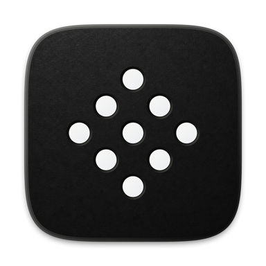

<p align="center">
  
</p>

<p align="center">
  <a href="https://btx.so">btx.so</a>
</p>

<h1 align="center">BTX for iOS and MacOS</h1>

<p align="center">
  <strong>Support your customers. Understand their devices.</strong><br>
  Customer Messenger, feedback, and product context inside your companion app.
</p>

<p align="center">
  <a href="docs/quickstart.md"><strong>Get started →</strong></a>
  &nbsp; · &nbsp;
  <a href="docs/README.md">Developer guides</a>
  &nbsp; · &nbsp;
  <a href="docs/macos.md">macOS</a>
  &nbsp; · &nbsp;
  <a href="https://github.com/secondcontext/btx-ios-sdk/releases">Release notes</a>
</p>

<p align="center">
  iOS &nbsp; · &nbsp; macOS &nbsp; · &nbsp; Swift Package Manager
</p>

## Built into your app

<table>
  <tr>
    <td colspan="2">
      <h3><a href="docs/customer-messenger.md">Customer Messenger →</a></h3>
      <p>Give customers a direct line to your team. Open support from a device error and bring the firmware, battery, and connection state into the thread.</p>
      <p><code>BTX.messenger.present()</code></p>
    </td>
  </tr>
  <tr>
    <td width="50%" valign="top">
      <h3><a href="docs/help-center.md">Help Center →</a></h3>
      <p>Put pairing, charging, and firmware guides where customers need them, inside your app.</p>
    </td>
    <td width="50%" valign="top">
      <h3><a href="docs/feedback.md">Shake For Feedback →</a></h3>
      <p>A shake opens an issue report with a screenshot the customer can review before sending. Customers can also take a camera photo; add NSCameraUsageDescription to the host app’s Info.plist.</p>
    </td>
  </tr>
  <tr>
    <td width="50%" valign="top">
      <h3><a href="docs/telemetry.md">Telemetry →</a></h3>
      <p>Connect a support report to Bluetooth failures, device syncs, and firmware-update outcomes.</p>
    </td>
    <td width="50%" valign="top">
      <h3><a href="docs/feature-flags.md">Feature flags →</a></h3>
      <p>Roll out a new companion-app experience to selected customers, with a fallback for everyone else.</p>
    </td>
  </tr>
</table>

## From package to first reply

**1. Add the package in Xcode**

```text
https://github.com/secondcontext/btx-ios-sdk.git
```

Select **3.8.1 or later** and add the **BTXClientKit** product to your app target.

**2. Configure and identify**

Follow the [iOS quickstart](docs/quickstart.md) to configure BTX once and identify
the signed-in customer.

**3. Open Customer Messenger**

Send a message from your app, reply from BTX, and see the thread update in the app.
Messaging works without push setup while the app is running. On macOS with SDK
3.5.1 or later, an unread reply can show a toast in a visible registered window
with Support closed, even when another app has focus.

---

**Make it yours** · [Theming](docs/theming.md) · [Push notifications](docs/push-notifications.md) · [API reference](docs/api-reference.md)

**Explore more** · [Community and Campaigns](docs/additional-features.md)

Enable only what your app needs. Customer Messenger is enabled by default;
Help Center, telemetry, and automatic feedback triggers are opt-in.

On macOS, `BTXMessengerOptions.macOS` groups optional panel presentation, panel
styling, and compact home layout controls. Window-specific insets can change
while Support is open, preserving the thread and draft. See the
[macOS guide](docs/macos.md#customize-native-presentation).
SDK 3.7.0 also supports an optional header divider, button and Threads-label letter
spacing, timestamp font, bubble stroke, and composer radius and stroke through
`BTXMacOSPanelStyle`. The thread count sits beside its label, and team avatars use
customer-visible initials while photos load or fail.

**Image campaigns on iOS** require 3.8.0 or later. Customers tap the artwork to
open the campaign action and use the close button to dismiss it. See
[In-app campaigns](docs/additional-features.md#in-app-campaigns).

## Attach a trace to a topic

Pass an AI result's nonzero, 32-character OpenTelemetry trace ID on the shared
launch context. The SDK shows it on the feedback topic; desktop reads the same
attachment. No custom attributes or trace rows are needed.

```swift
let context = BTXLaunchContext(
    conversationPurpose: .feedback,
    sourceType: "reply_draft",
    sourceID: draft.id,
    traceID: draft.traceID,
    threadIntro: .card(title: "Reply draft", subtitle: draft.text)
)

BTX.messenger.presentFeedbackReport(
    rating: .negative,
    prompt: BTXFeedbackPrompt(subject: "Reply draft", question: "What went wrong?"),
    launchContext: context
)
```

The same context works with `submitFeedback`, messenger entry points, and other
cards. The feedback methods also accept `traceID` directly as a convenience.
IDs are normalized to lowercase. Invalid explicit IDs clear a stale attachment
without blocking feedback or changing its topic. An optional `traceTimestamp`
accepts the known AI interaction time to narrow provider reads; it is not needed
to attach or display the ID. Feedback and queued retries retain the reference.
The SDK does not export traces or handle Langfuse credentials. A stable
`sourceType` and `sourceID` keep rating changes for the same AI result in one
feedback thread. Generic shake and screenshot reports do not select a trace.

## Request recovery

Invalid keys and mismatched app identifiers stop automatic requests for that
configuration. Correct the client configuration before retrying; creating a new
controller or identifying another customer does not reset the block. A new app
process starts with a fresh authentication probe.

Temporary failures use randomized delays around two and four seconds. Three
failed attempts pause automatic requests for at least five minutes before one
recovery probe. Server `Retry-After` values remain the minimum wait. Messenger
requests share one session renewal after an expired bearer token and replay once;
a rejected replay stops recovery for that token. Forbidden operations do not
renew credentials. Read retries have a 20-second budget. Writes are not replayed
after uncertain network failures. Pending messages retain their identifiers.
Telemetry timers pause in the background and retain cooldowns on foregrounding.
