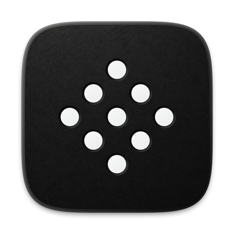

<p align="center">
  
</p>

<p align="center">
  <a href="https://btx.so">btx.so</a>
</p>

<h1 align="center">BTX for iOS and MacOS</h1>

<p align="center">
  <strong>Support your customers. Understand their devices.</strong><br>
  Customer Messenger, feedback, and product context inside your companion app.
</p>

<p align="center">
  <a href="docs/quickstart.md"><strong>Get started →</strong></a>
  &nbsp; · &nbsp;
  <a href="docs/README.md">Developer guides</a>
  &nbsp; · &nbsp;
  <a href="docs/macos.md">macOS</a>
  &nbsp; · &nbsp;
  <a href="https://github.com/secondcontext/btx-ios-sdk/releases">Release notes</a>
</p>

<p align="center">
  iOS &nbsp; · &nbsp; macOS &nbsp; · &nbsp; Swift Package Manager
</p>

## Built into your app

<table>
  <tr>
    <td colspan="2">
      <h3><a href="docs/customer-messenger.md">Customer Messenger →</a></h3>
      <p>Give customers a direct line to your team. Open support from a device error and bring the firmware, battery, and connection state into the thread.</p>
      <p><code>BTX.messenger.present()</code></p>
    </td>
  </tr>
  <tr>
    <td width="50%" valign="top">
      <h3><a href="docs/help-center.md">Help Center →</a></h3>
      <p>Put pairing, charging, and firmware guides where customers need them, inside your app.</p>
    </td>
    <td width="50%" valign="top">
      <h3><a href="docs/feedback.md">Shake For Feedback →</a></h3>
      <p>A shake opens an issue report with a screenshot the customer can review before sending. Customers can also take a camera photo; add NSCameraUsageDescription to the host app’s Info.plist.</p>
    </td>
  </tr>
  <tr>
    <td width="50%" valign="top">
      <h3><a href="docs/telemetry.md">Telemetry →</a></h3>
      <p>Connect a support report to Bluetooth failures, device syncs, and firmware-update outcomes.</p>
    </td>
    <td width="50%" valign="top">
      <h3><a href="docs/feature-flags.md">Feature flags →</a></h3>
      <p>Roll out a new companion-app experience to selected customers, with a fallback for everyone else.</p>
    </td>
  </tr>
</table>

## From package to first reply

**1. Add the package in Xcode**

```text
https://github.com/secondcontext/btx-ios-sdk.git
```

Select **3.5.0 or later** and add the **BTXClientKit** product to your app target.

**2. Configure and identify**

Follow the [iOS quickstart](docs/quickstart.md) to configure BTX once and identify
the signed-in customer.

**3. Open Customer Messenger**

Send a message from your app, reply from BTX, and see the thread update in the app.
Messaging works without push setup while the app is running. On macOS with SDK
3.5.1 or later, an unread reply can show a toast in a visible registered window
with Support closed, even when another app has focus.

---

**Make it yours** · [Theming](docs/theming.md) · [Push notifications](docs/push-notifications.md) · [API reference](docs/api-reference.md)

**Explore more** · [Community and Campaigns](docs/additional-features.md)

Enable only what your app needs. Customer Messenger is enabled by default;
Help Center, telemetry, and automatic feedback triggers are opt-in.

On macOS, `BTXMessengerOptions.macOS` groups optional panel presentation, panel
styling, and compact home layout controls. Window-specific insets can change
while Support is open, preserving the thread and draft. See the
[macOS guide](docs/macos.md#customize-native-presentation).
SDK 3.7.0 also supports an optional header divider, button and Threads-label letter
spacing, timestamp font, bubble stroke, and composer radius and stroke through
`BTXMacOSPanelStyle`. The thread count sits beside its label, and team avatars use
customer-visible initials while photos load or fail.
